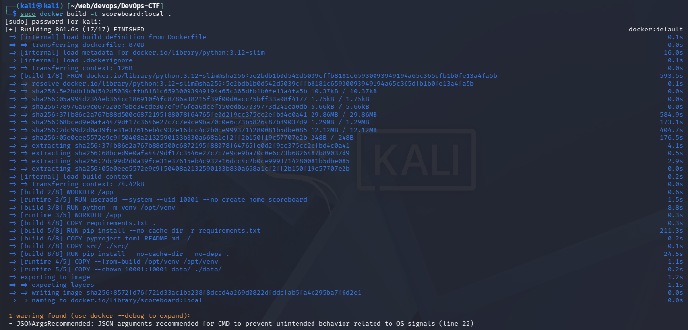
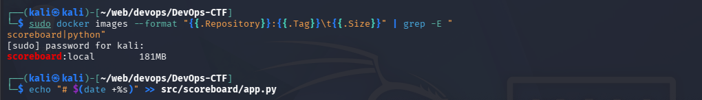
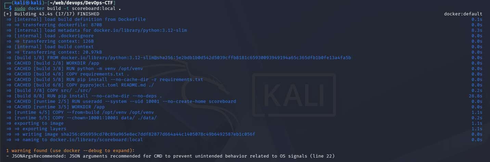
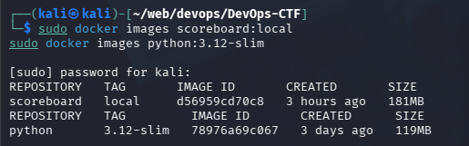
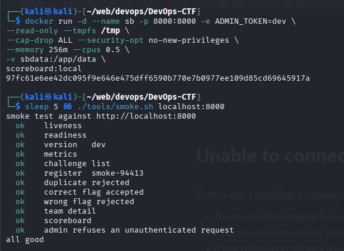
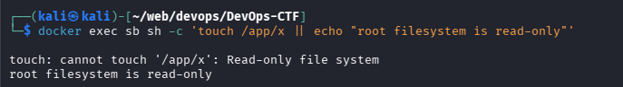
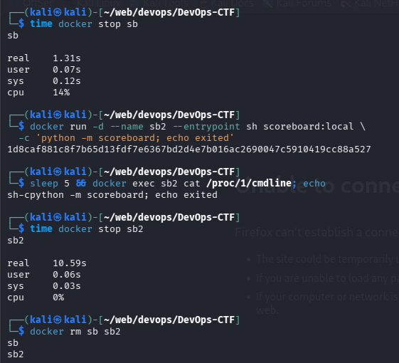
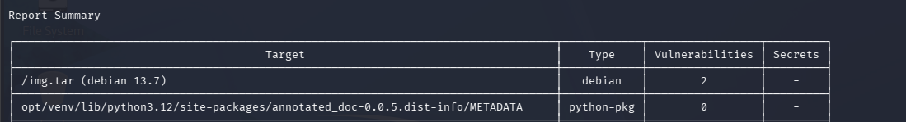
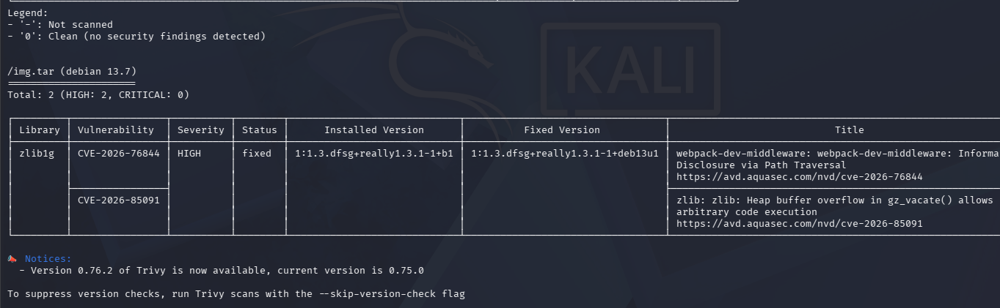
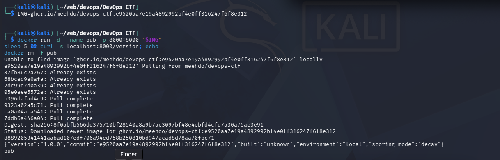

# Lab 3 Report

**Course:** DevOps  
**University:** Amar El Telidj University

## Students

- ALLALI Mohammed Mehdi
- ELGUAIZI Mohamed
- GADOUAR Islam

[Github Repo](http://github.com/meehdo/DevOps-CTF/)

---

# Exercise 1

### (a) Give the size of scoreboard:local and the size of python:3.12-slim

**Answer:**

- `scoreboard:local`: **181 MB**
- `python:3.12-slim`: **119 MB**

### (b) Name two things that are in the build stage but not in the runtime image

**Answer:**
`/app/src/` and `/app/requirements.txt`

### (c) For each of these two things, explain why its absence makes the image more secure

**Answer:**

- `/app/requirements.txt`:avoids exposing the project’s dependencies and versions constraints

- `/app/src/`:avoids shipping the raw build source

### (d) COPY requirements.txt comes before COPY src/. Why? Use what the second build printed

**Answer:**

Because the requirements usually change less than the source code and thus can be cached and
reused.

If that step were after copy src/. then every time the src changes (which is often) it would also have to rebuild the requirements all over again , evenif they haven't changed and wasting time

This is because if a build has changed it would invalidate the cache of any steps after it.

---

# Exercise 2

### (a) Which mount makes this possible?

**Answer:**

The named volume mount `sbdata:` makes database writes possible , this is because the readonly flag blocks writes to the container’s root file system not the mounted volume

### (b) Why is it a named volume (sbdata) and not the host folder $PWD/data?

**Answer:**

The named volume is managed by docker independently of the container and the current directory , using the host folder means the data will have to be managed by the user.

### (c) Imagine that an attacker can run code inside the container. Choose two other options of the docker run command. For each one, say what the attacker can no longer do

**Answer:**

`--cap-drop ALL` : removes Linux capabilities, so an attacker can’t perform privileged operations that require them

`--security-opt no-new-privileges`: prevents a process from gaining extra privileges

---

# Exercise 3

### (a) Give both stop times

**Answer:**

- `sb`: 1.31 seconds

- `sb2`: 10.59 seconds

### (b) Explain the difference. Use the words PID 1 and SIGTERM

**Answer:**

Running docker stop sends a SIGTERM to the docker container's main process PID1 and waits for it to exit , if it doesn't exit after a grace period of 10 seconds docker send SIGKILL to force close it.

For sb PID 1 is Uvicorn so docker sends the SIGTERM to it and it closes and the container stops after 1.31 seconds

For sb2 PID 1 is the shell so it receives the SIGTERM but it doesn't forward it to its python child process

After the grace the period of 10 seconds it doesn't close so docker force closes it with SIGKILL

### (c) A rolling update replaces twenty replicas, one after the other. What does this difference cost during such an update?

**Answer:**

10.59 − 1.31 = 9.28 seconds per replica

For 20 sequential replacements

9.28 * 20 = 185.6 seconds

so the difference costs about 185.6 seconds during and update

---

# Exercise 4

### (a) How many findings are there, and in which packages?

**Answer:**

2 findings in zlib1g

### (b) In lab sheet 2, `pip-audit` found nothing for the same application. Explain the difference

**Answer:**

pip-audit checks just the python packages, while the trivy scan checks the container image

### (c) In two lines: why is the scanner itself pinned (a fixed version)?

**Answer:**

It makes the results reproducible between runs and avoids breaking the pipeline due to unforseen changes in an update

---

# Exercise 5

### (a) The commit identifier travels from Git to the running process. Name these different steps

**Answer:**

- First a commit is created locally with its corresponding hash
- The hash is then passed into the CI workflow and used as a build argument
- The image is tagged with the commit hash
- The dockerfile puts the value as an environment variable
- The application can then access the hash

### (b) In a later lab sheet, two versions of the application run at the same time. Imagine that both images have the tag `latest`. Give one concrete problem

**Answer:**

If both images used the latest tag then they would overwrite each other

